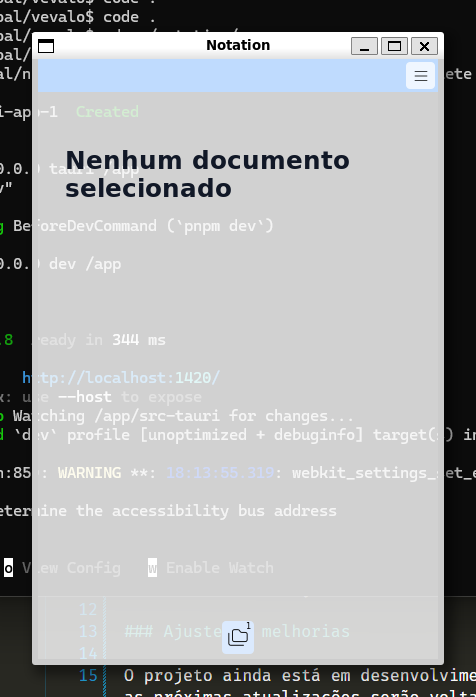

# Notation




> Notation é um SaaS de anotações que imita meu sistema de anotações pessoal, porem integrado a uma inteligência artificial que vai criar exercícios baseados nas anotações.

### Ajustes e melhorias

O projeto ainda está em desenvolvimento e as próximas atualizações serão voltadas para as seguintes tarefas:

- Sistema
  - [ ] Payment
  - [ ] Shared notations
  - [ ] Login

- Sistema de arquivos
  - [x] Tabs
  - [x] Folders
  - [ ] Search
  - [ ] "CRTL + k"

- Editor
  - [x] Headings
  - [x] Bold
  - [x] Unordered and ordered lists
  - [x] Highlights for after search's
  - [ ] Placeholder (Trailing)
  
- Estudos
  - [ ] I.A. for Exercises
  - [ ] Recurring reminders
  - [ ] Wiki integration for tags resumes

## 💻 Pré-requisitos

Antes de começar, verifique se você atendeu aos seguintes requisitos:

- Você precisa da versão `26.1.4` ou superior do `<Docker>`.
- Você precisa da versão `2.27.1` ou superior do `<Docker Compose>`.

## 🚀 Instalando Notation

Para instalar o notation, siga estas etapas:

Linux e macOS:

```
$ docker-compose up
```

## 📝 Licença

Esse projeto está sob a licença Apache 2.0. Veja o arquivo [LICENSE](LICENSE) para mais detalhes.
